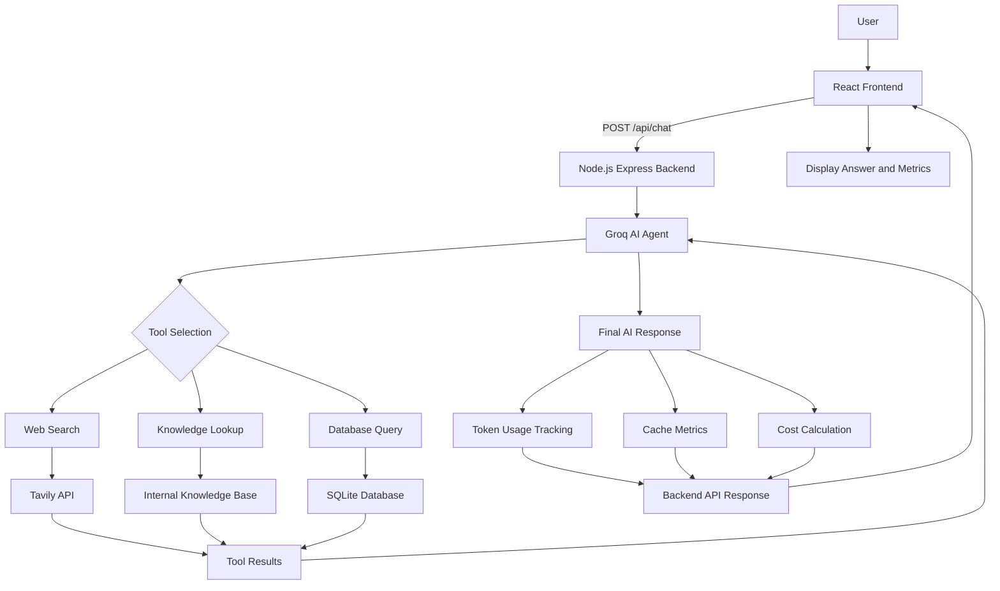

# AI Research Assistant – System Architecture

## Architecture Diagram

## Architecture Explanation

1. **User:** Enters a research question.
2. **React Frontend:** Sends the question to the backend.
3. **Node.js Backend:** Receives and validates the request.
4. **Groq AI Agent:** Decides which research tools are needed.
5. **Research Tools:**
   - Web Search retrieves online information using Tavily.
   - Knowledge Lookup searches the internal knowledge base.
   - Database Query retrieves relevant SQLite records.
6. **Tool Results:** Are returned to the AI agent for processing.
7. **Final Response:** The AI agent generates the research answer.
8. **Monitoring:** Token usage, cache metrics, and estimated API costs are collected.
9. **Frontend:** Displays the answer and available metrics.

## Technology Components

| Layer | Technology |
|---|---|
| User Interface | React, TypeScript |
| Backend API | Node.js, Express |
| AI Agent | Groq API |
| Web Search | Tavily |
| Knowledge Storage | Internal Knowledge Base |
| Database | SQLite |
| Monitoring | Token, Cache and Cost Tracking |
